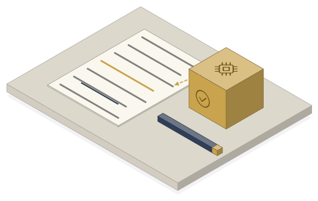

# Docs that look good

**Agents are amazing at bureaucracy.** Bureaucracy is documents plus rules: it repeats, it follows rules, it can be checked. That's exactly what agents are good at, as long as you hand them the rules.

This is the kit from **AI in Context, Episode 04** (live, October 29, 2026). Set it up once and every document comes out one page, in your look, in your voice, in about 2 minutes.

**Web version with copy buttons:** https://lemonbrand.github.io/docs-that-look-good/


## Make your first document in 10 minutes

Works in Claude and in ChatGPT. We tested both end to end on the day of the show: Claude made the PDF in about 2 minutes, ChatGPT (Thinking) in 1 min 52 s.

| | Claude (claude.ai) | ChatGPT |
|---|---|---|
| **1. Make a project** | Projects > New project | Projects > + |
| **2. Drop in 3 files** (+ your logo) | Upload to the project's files | Sources tab > Add sources |
| **3. Paste the six rules** | Project instructions | Project settings > Instructions |
| **4. Ask in one line** | New chat in the project | New chat in the project |

The 3 files are [`brand.md`](templates/brand.md), [`my-writing.md`](templates/my-writing.md) and [`outlines.md`](templates/outlines.md), plus `logo.png`. First time? Use the [sample folder](sample/) as is, see it work, then swap in your own.

What comes back: a one-page PDF in your colors with your logo, and under it a short list of anything it guessed. Read that list. It's the part that keeps you safe.

## The six rules (copy this into the project instructions)

```text
You make documents that look good and are right. Read the project files before every document.

Every document, every time:
1. Page. Letter size, one page unless I ask for more. Deliver a PDF I can download.
2. Outline. Start from the outline in outlines.md that fits. If none fits, use 3 to 5 plain headings.
3. Few words. Under 300 words a page. Short sentences. One idea per section. Use numbered steps or a small table when it saves words.
4. My voice. Write like the examples in my-writing.md: same tone, same sentence length, same words.
5. My look. Use the logo, colors and font in brand.md. Logo top left, lots of white space, one accent color, no clip art.
6. Check. Every fact comes from my message or the project files. Never invent names, prices, dates or numbers. Under the PDF, list anything you guessed or could not confirm.

If something you need is missing, make the document anyway with a clear [blank] and tell me what to fill.
```

Same text as a file: [`templates/INSTRUCTIONS.md`](templates/INSTRUCTIONS.md).

### Why each rule is there

| | Rule | What it fixes |
|---|---|---|
| 1 | **Page** | Without a page size you get a chat answer, not a document. |
| 2 | **Outline** | Your best documents already have a shape. Give it the shape, it fills it. |
| 3 | **Few words** | AI writes long by default. A page you can read in one minute gets read. |
| 4 | **My voice** | Three things you wrote yourself beat any "write in a friendly tone". |
| 5 | **My look** | Logo, colors, one font, one accent. That's most of looking professional. |
| 6 | **Check** | It tells you what it guessed instead of making it up. You check that list, not the whole page. |

## Then ask in one line

The one we tested ([`sample/prompt.txt`](sample/prompt.txt)):

```text
Welcome sheet for new clients.

My notes: we do monthly bookkeeping and payroll for small shops. Clients send receipts through the Dext app (photo is fine), bank access read-only, payroll hours by the 25th. Books closed by the 10th of the next month. They get a one-page summary every month. Questions: text Dana at 519-555-0142, same-day answer on weekdays.
```

Yours: the document name, then your rough notes. That's it. The rules do the rest.

Second one to try, same project ([`sample/prompt-doc.txt`](sample/prompt-doc.txt), a made-up florist):

```text
One-page proposal for Bloom & Twig Florist.

My notes: owner Priya, 2 shops, 6 staff. Receipts live in a shoebox, payroll done by hand every two weeks. She wants the books closed every month and payroll off her plate. Our price: $450 a month, starts November 1.
```

## Step 5: add your own pictures

Upload [`pictures.md`](templates/pictures.md) and your approved pictures, named `pic-something.png`. It then puts at most one per page, the one that fits, and never invents clip art. The sample has five ([`sample/pic-*.png`](sample/)). Making your own set is below in "Make your own pictures".

## Bonus: pretty charts

Upload [`charts.md`](templates/charts.md) (seven rules: one question per chart, the title is the answer, one accent color, labels on the bars, a source line) and a spreadsheet saved as CSV. Then one line:

```text
Chart from sample-data.csv: where did our hours go this year?
```

You get the chart as a PNG on a one-page PDF with two sentences on what it means. Try it with [`sample/sample-data.csv`](sample/sample-data.csv) (made-up hours by task), then use your own export.

## Fill in your own

| File | What goes in | Time |
|---|---|---|
| [`templates/brand.md`](templates/brand.md) | Your colors (hex codes), your font, your footer line | 3 min |
| [`templates/my-writing.md`](templates/my-writing.md) | Three short things you wrote yourself, not with AI | 3 min |
| [`templates/outlines.md`](templates/outlines.md) | The headings of documents you send again and again | 3 min |
| `logo.png` | Your logo | 1 min |
| [`templates/pictures.md`](templates/pictures.md) + `pic-*.png` | Your approved pictures (optional) | 2 min |
| [`templates/charts.md`](templates/charts.md) | Chart rules. Works as is, swap in your colors (optional) | 1 min |

Don't know your hex codes? Upload your logo to the chat and ask for them.

## The sample

[`sample/`](sample/) is **Maple Street Bookkeeping, a made-up business**. The address, the email, Dana, the 555 phone number, the hours in the CSV, and the florist and its price are all made up. It's the exact set we ran live, with three prompts: a welcome sheet, a proposal and a chart.

## Make your own pictures

Stock pictures make you look like everyone. Your own set, in one style, makes every document look like yours.

**ChatGPT: your style, about 45 seconds a picture.** Attach two style images, paste one prompt, change only the subject line. Prompt and style images: [`pictures/chatgpt/`](pictures/chatgpt/).

**Claude: drawn as code, about 2 minutes a picture.** A project that draws flat isometric scenes with a small Python library. Same look every time, and you can edit it. Files and setup: [`pictures/claude-iso/`](pictures/claude-iso/).

| ChatGPT, paper collage | Claude, drawn as code |
|---|---|
|  |  |

## Keep it in your Drive, not in the chat

Four folders and you stop starting from zero:

- **Brand**: logo, colors, your writing
- **Library**: pictures you approved
- **Templates**: outlines that worked
- **Docs**: finished PDFs

The whole kit as a Drive folder: https://drive.google.com/drive/folders/1QGie-9-fDio3Y9-Bb89haRqZoyRQExNK

## What's in here

```text
README.md                 you are here
index.html                the web version (copy buttons)
after-brief.pdf           the 4-page brief from the show
templates/                blank files to fill with your own
sample/                   Maple Street Bookkeeping (made up): the tested set, 3 prompts, 5 pictures, chart data
pictures/chatgpt/         image prompt + two style images
pictures/claude-iso/      the "draw it as code" Claude project
canvas/                   the show's canvas: PNG, and .excalidraw (open it at excalidraw.com)
```

## Next

- Next live sessions (free, Thursdays 1 PM ET): https://luma.com/ai-in-context
- Everything else from Simon: https://lemonbrand.io/start

Made by Simon Bergeron, [Lemonbrand](https://lemonbrand.io). Use it, change it, share it.
